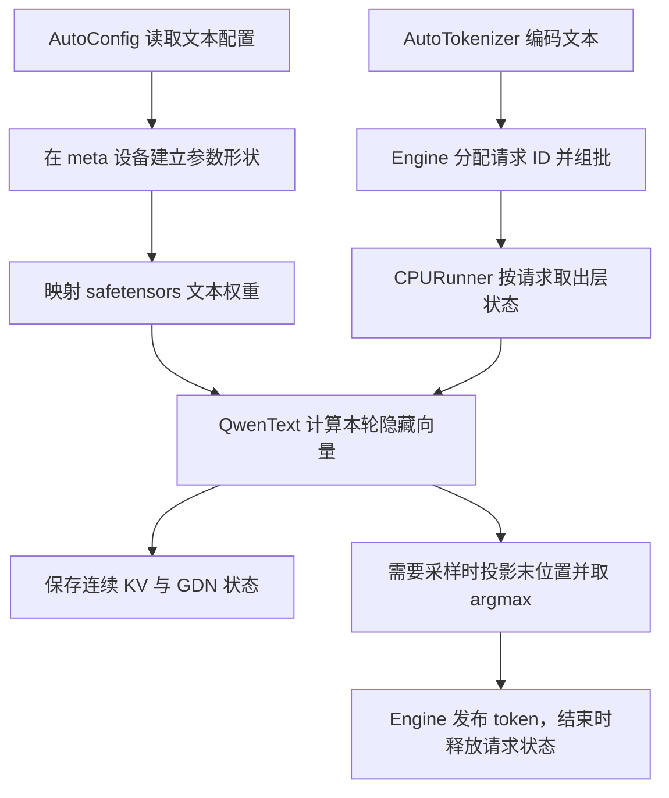

# 从 checkpoint 到第二个生成 token

这条路径使用 PyTorch 的普通张量算子执行 Qwen3.8-27B 的文本主干。第一步用整段提示词得到下一个 token；第二步只送入这个新 token，继续使用前一步的逐层状态。两步分别检验权重、位置和缓存。此实现提供后续分页和融合算子的数值基线。



## 权重如何装入自己的模型

先通过 AutoConfig 取 text_config，其中 layer_types 决定每一层使用 GDN 还是全注意力。加载器先在 meta 设备建立模块，以参数名和形状描述模型，此时没有分配随机的 27B 权重。然后逐个打开 safetensors 分片，将 model.language_model 前缀下的参数映射到文本主干，并单独处理 lm_head.weight。视觉参数和 MTP 分支属于此 checkpoint 的其他计算路径。

例如，`model.language_model.layers.0.linear_attn.A_log` 映射到 `layers.0.linear_attn.A_log`。先检查名称、形状及重复键，再以 strict=True、assign=True 绑定张量。这让缺少一层权重直接表现为加载错误，也避免为目标参数额外复制完整模型。[加载器](../myvllm/cpu_runner.py) · [模型结构](../myvllm/qwen_text.py)

## 两类层要保存什么

全注意力保存形状为 `[KV 头数, 已处理 token 数, 头维度]` 的 K 和 V。对于纯文本，三个 MRoPE 位置轴使用相同位置，可直接对每个头的旋转部分做一维 RoPE。假设旧 KV 有两个位置，本轮再输入两个 token，本轮第一个 query 位于位置 2，能看到键 0、1、2；第二个 query 可以再看到键 3。代码用 query 的绝对位置构造因果掩码。若直接对这个 2×4 矩阵取左上角下三角，会错误地遮住历史上下文。

GDN 保存两部分。卷积历史是最近 `kernel_size - 1` 个原始投影；新块与这段历史拼接后，跨块的第一个 token 也有完整左上下文。递归记忆 S 用 FP32，形状为 `[value 头数, key 维度, value 维度]`。对每个 token，先按学习到的衰减系数缩放 S，用 k 读取预测值，再以 beta 调节的预测误差更新 S，最后用 q 读取输出。拆成多个块时，两类状态都按请求 ID 传给下一步。

CPURunner 在一轮内依次执行请求，先收集全部新状态，再更新请求表。计算新状态时保留旧张量，因此同批较晚的请求报错时，较早的请求还能从原位置重试。中间 prefill 块保留状态并跳过输出投影，完整 prompt 的末位置和每次 decode 才投影到词表。Engine 判定 EOS 或达到输出上限时调用 release。[请求执行](../myvllm/cpu_runner.py) · [请求结束](../myvllm/engine.py)

## 复现生成与数值验证

先安装与系统匹配的 PyTorch；需要 CPU wheel 时，可在独立 Python 环境中执行以下命令。模型目录应包含官方 BF16 配置、分词器和 safetensors 分片。命令中的提示词走原始文本补全路径。

```bash
python -m pip install torch --index-url https://download.pytorch.org/whl/cpu
python -m pip install -e '.[model]'
export OMP_NUM_THREADS=16 MKL_NUM_THREADS=16
export MODEL_DIR=/path/to/Qwen3.8-27B
python -m myvllm.generate "$MODEL_DIR" 'The capital of France is' --max-new-tokens 2
python scripts/compare_cpu_logits.py "$MODEL_DIR" --steps 3
python -m unittest discover -s tests -v
```

比对脚本先用 Transformers 的官方类运行，在每一步保存末位置的整词表 logits，再释放模型并加载 MyVLLM。两个后端使用相同的输入 token，即使某一步选出的 token 不同，也可以继续定位误差。脚本给出贪心结果以及逐词表元素的最大和平均绝对差。缩小配置的自动测试还逐位置比较分块结果与 Transformers 的整段重算，覆盖多 token chunk、连续 decode 和请求状态释放。[比对脚本](../scripts/compare_cpu_logits.py) · [数值测试](../tests/test_cpu_model.py)

## 实测记录

在官方 BF16 权重、PyTorch 2.15.0+cpu、Transformers 5.22.1、eager attention 和 16 个计算线程下，提示词 `The capital of France is` 编码为 `[760, 6511, 314, 9338, 369]`。MyVLLM 通过 Engine 生成两个 token，文本为 ` Paris.`（含前导空格）。随后逐步对照官方模型，得到以下整词表误差。[权重 revision](https://huggingface.co/Qwen/Qwen3.8-27B/tree/37561816e66b5b9153b1b64c10968c18c1e6f4a0)

| 步骤 | Transformers / MyVLLM 的 argmax | 最大绝对差 | 平均绝对差 |
|---|---|---:|---:|
| prefill，位置 0–4 | 11751 / 11751 | 0.125000 | 0.019474 |
| decode，位置 5 | 13 / 13 | 0.125000 | 0.018039 |
| decode，位置 6 | 198 / 198 | 0.125000 | 0.017827 |

三个位置的 greedy 选择一致，BF16 logits 存在可测的数值差异。本次记录覆盖单条短提示词。FP32 小配置用严格容差检验公式及分块一致性；真实 BF16 数据用于追踪整个模型的累计误差。CPU 后端按请求串行执行，持续拼接 KV，并对 GDN 逐 token 递推，正式性能对测另行进行。
