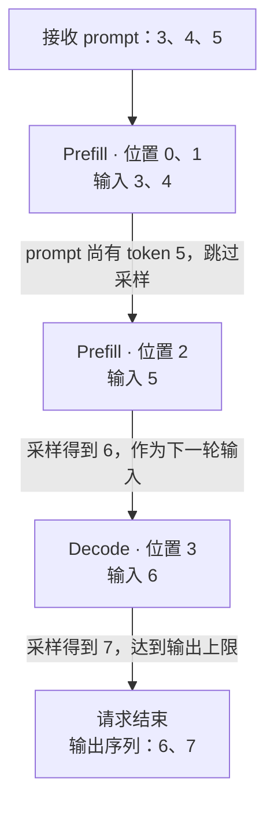

# 逐步运行一次推理循环

给定三个输入 token，每轮最多处理两个，生成两个输出。需要几轮模型执行？要回答这个问题，先分清两个计数。请求的 `computed` 表示已经作为模型**输入**处理的 token 数，`generated` 表示已经作为**输出**交给调用方的 token 数。采样出一个新 token 的瞬间，它还没有进入下一轮前向。位置从 0 开始。

## 运行这个例子

在仓库根目录运行下面的 Python 代码。执行后端用“末 token 加一”生成确定的返回值，使每个结果的来源都能用手核算。真实模型会在同一接口从 logits 采样。Python 包直接放在仓库根目录，可以直接运行本例。

```python
from myvllm import Engine

class TraceRunner:
    def execute(self, batch):
        for item in batch:
            print(item.phase.value, item.position, item.token_ids, item.sample)
        return {item.request_id: item.token_ids[-1] + 1 for item in batch if item.sample}

engine = Engine(TraceRunner(), token_budget=2)
engine.add_request([3, 4, 5], max_new_tokens=2)
while engine.has_requests:
    print(engine.step())
```

预期轨迹如下。最后一个布尔值表示当前位置是否需要采样。

```text
prefill 0 (3, 4) False
[]
prefill 2 (5,) True
[TokenEvent(request_id=0, token_id=6, finished=False)]
decode 3 (6,) True
[TokenEvent(request_id=0, token_id=7, finished=True)]
```

## 三轮中各发生了什么



| 轮次 | 为什么选择这段输入 | 完成后的状态 |
|---|---|---|
| 1 | prompt 尚有三个 token，本轮预算为二。调度器从位置 0 取出 3、4。此时 prompt 还有已知的后续输入 5，在这里采样会提前生成。 | computed=2，generated=0。返回空列表，请求仍然活跃。 |
| 2 | 从位置 2 取出 5。现在整个 prompt 都进入了计算，末位置的 logits 可用于生成第一个新 token 6。 | computed=3，generated=1，last_token=6。 |
| 3 | 请求进入 decode。输入是刚生成的 6，它的逻辑位置等于 computed，即 3。用这一位置的输出采样得到 7。 | computed=4，generated=2。达到输出上限，最后一个事件携带 finished=True，请求退出。 |

[调度器](../myvllm/scheduler.py)从预算里扣除本轮实际送入模型的 token 数。一条请求用完预算时，同轮停止组批；若仍有余额，可继续接纳同阶段请求。[引擎](../myvllm/engine.py)只在收到本轮执行结果后增加 computed。若在“分配预算”和“执行完成”两个地方各加一次，第二轮就会跳过位置 2。这也是将组批设计为只读操作的原因。

## 自己验证两种边界

1. 把 `token_budget` 改为 3。第一轮即可得到 token 6，整次生成缩短为两轮，decode 的起始位置仍然是 3。改变切块策略应保留逻辑位置。
2. 给 Engine 增加 `eos_ids=[6]`。第二轮会产生结束事件，不再调度位置 3。终止条件应在输出产生后检查。

从根目录运行 `python -m unittest discover -s tests -v`。[控制流测试](../tests/test_engine.py)逐轮断言输入、位置、采样和结束事件，并检查交错到达的请求与 EOS。真实 logits 的数值验证见 [CPU 文本模型](cpu-model.md)。
